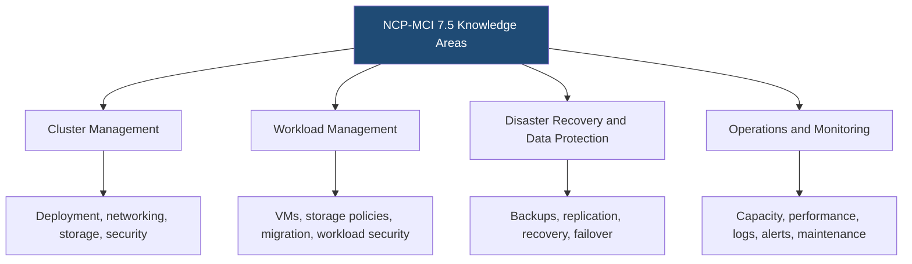
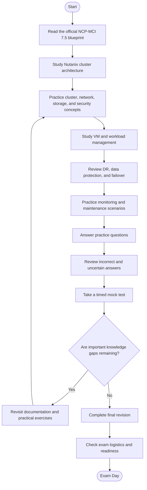
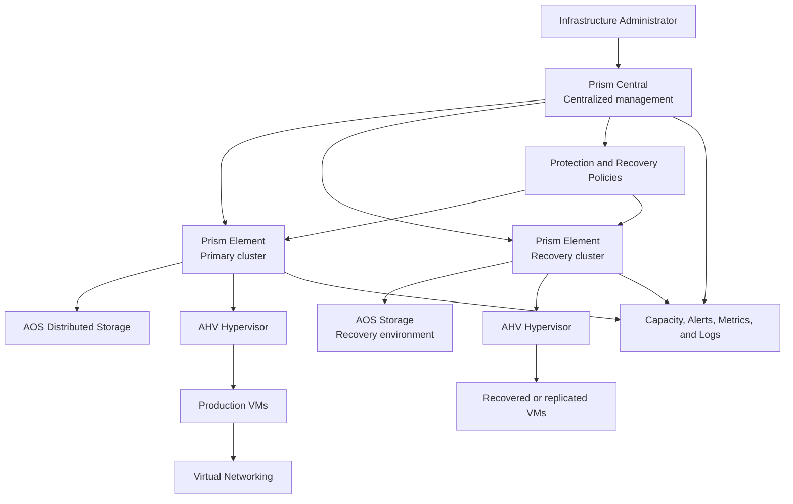
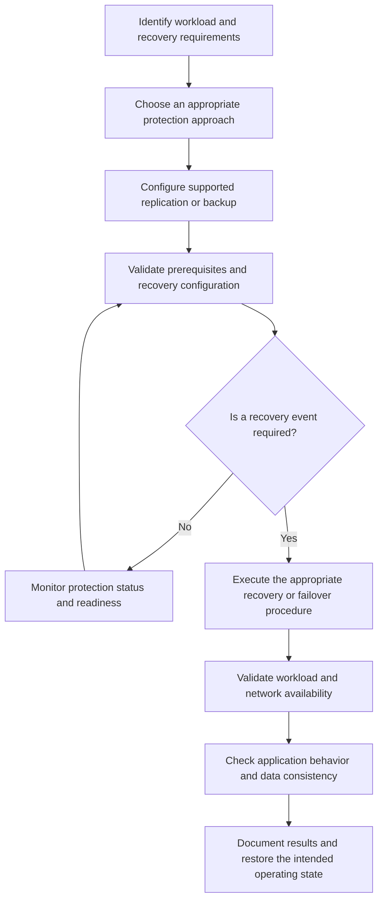
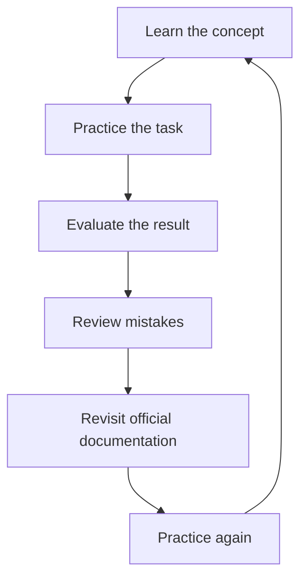
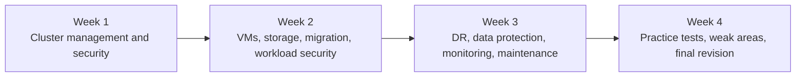

# Nutanix Certified Professional – Multicloud Infrastructure (NCP-MCI 7.5) Study Guide

A practical, community-focused study guide for the **Nutanix Certified Professional – Multicloud Infrastructure (NCP-MCI) 7.5 certification exam**. This repository organizes the official exam objectives into study topics, technical diagrams, practice questions, and hands-on learning projects.

The guide focuses on managing Nutanix infrastructure across multicloud environments, including cluster configuration, Prism Central, AHV virtual machines, storage, security, disaster recovery, workload migration, capacity planning, performance monitoring, and cluster maintenance.

Use this resource alongside the official Nutanix exam blueprint and product documentation. For additional independent study material, visit [CertsGate](https://certsgate.com/).

> **Version note:** This guide targets NCP-MCI 7.5. The official blueprint identifies AOS 7.5, AHV 11.0, and Prism Central pc.7.5 as the tested software versions. Verify the current blueprint before scheduling an exam.

---

## Table of Contents

- [About the NCP-MCI Certification](#about-the-ncp-mci-certification)
- [Who Should Prepare?](#who-should-prepare)
- [Exam Details](#exam-details)
- [Official Exam Objectives](#official-exam-objectives)
- [Conceptual Skills Map](#conceptual-skills-map)
- [Certification Preparation Flowchart](#certification-preparation-flowchart)
- [Nutanix Multicloud Architecture](#nutanix-multicloud-architecture)
- [Disaster Recovery Workflow](#disaster-recovery-workflow)
- [Circular Study Cycle](#circular-study-cycle)
- [Step-by-Step Preparation Guide](#step-by-step-preparation-guide)
- [Four-Week Study Roadmap](#four-week-study-roadmap)
- [Hands-On Practice Projects](#hands-on-practice-projects)
- [NCP-MCI Practice Questions](#ncp-mci-practice-questions)
- [Troubleshooting Reference](#troubleshooting-reference)
- [Common Preparation Mistakes](#common-preparation-mistakes)
- [Readiness Checklist](#readiness-checklist)
- [Career Relevance](#career-relevance)
- [Frequently Asked Questions](#frequently-asked-questions)
- [Official and Additional Learning Resources](#official-and-additional-learning-resources)
- [About CertsGate](#about-certsgate)

---

## About the NCP-MCI Certification

The **Nutanix Certified Professional – Multicloud Infrastructure (NCP-MCI)** certification validates the ability to interpret documented standards and perform key administrative tasks in a Nutanix multicloud environment.

The NCP-MCI 7.5 exam covers more than basic navigation. Candidates should understand how to deploy and configure clusters, manage virtual machine workloads, protect data, configure disaster recovery, investigate performance issues, plan capacity, and maintain the platform.

The exam is particularly relevant to administrators and engineers responsible for keeping virtual infrastructure available, secure, and operational. Preparation should combine product knowledge with scenario-based reasoning: for example, choosing an appropriate storage configuration, planning a VM migration, interpreting a health-check failure, or determining how a workload should be protected.

Official starting points:

- [NCP-MCI certification details](https://www.nutanix.com/en_gb/support-services/training-certification/certifications/certification-details-nutanix-certified-professional-multicloud-infrastructure-v6-10)
- [Official NCP-MCI 7.5 Exam Blueprint Guide (PDF)](https://www.nutanix.com/content/dam/nutanix/en/resources/datasheets/ds-ebg-ncp-mci.pdf)

## Who Should Prepare?

This NCP-MCI 7.5 study guide is useful for:

- Nutanix infrastructure administrators.
- Virtualization and systems engineers.
- Infrastructure operations teams.
- Tier 1 and Tier 2 support professionals.
- Network or security operations personnel who support Nutanix environments.
- IT professionals responsible for VM migration, cluster maintenance, monitoring, and data protection.

### Recommended background

Nutanix describes the intended candidate as having approximately **one or more years of general IT infrastructure experience and equivalent Nutanix experience**.

Candidates should be familiar with deploying, configuring, migrating, troubleshooting, expanding, and managing Nutanix infrastructure. Nutanix recommends training such as its Enterprise Cloud Administration (ECA) course.

If cluster administration is new to you, first build a solid understanding of virtualization, networking, distributed storage, and basic infrastructure operations.

---

## Exam Details

The following details are published in the official NCP-MCI 7.5 blueprint.

| Exam information | Published detail |
|---|---|
| Certification | Nutanix Certified Professional – Multicloud Infrastructure |
| Exam version | NCP-MCI 7.5 |
| Question format | Multiple-choice and multiple-response |
| Number of questions | 75 |
| Time limit | 120 minutes |
| Passing score | 3000 on a scaled score range of 1000–6000 |
| Published price | US$200 per attempt |
| Languages | English and Japanese |
| Delivery | Remote proctoring or in-person at select test centers |
| Certification validity | Three years |
| Tested AOS version | 7.5 |
| Tested AHV version | 11.0 |
| Tested Prism Central version | pc.7.5 |

**Important:** A scaled passing score is not the same as a percentage of questions answered correctly. Pricing, policies, and exam availability can change, so review the [official exam blueprint](https://www.nutanix.com/content/dam/nutanix/en/resources/datasheets/ds-ebg-ncp-mci.pdf) before registering.

---

## Official Exam Objectives

The NCP-MCI 7.5 blueprint organizes the exam into four sections. These sections should guide your study plan and the way you review practice-question mistakes.

### Section 1 — Manage Clusters in a Multicloud Environment

This section covers the configuration, networking, storage, and security of Nutanix clusters.

#### Cluster deployment and configuration

Study how to:

- Gather configuration requirements before deployment.
- Differentiate between deployment methods.
- Select Controller VM (CVM) sizing based on required features.
- Configure required services.
- Perform node imaging.

#### Prism Central deployment

Understand how to:

- Select an appropriate Prism Central deployment based on requirements.
- Choose sizing according to required features.
- Scale Prism Central.
- Enable features and understand Policy Engine applications.

#### Network management

Review:

- Virtual switch configuration.
- Virtual subnet deployment.
- VPC configuration choices.
- Flow Load Balancing and traffic mirroring.
- Relevant host networking and connectivity considerations.

#### Cluster storage

Learn how to:

- Investigate storage shortages and possible responses.
- Select appropriate storage resiliency options.
- Understand reserved capacity and reserved space.
- Interpret storage configuration and utilization.
- Apply data resiliency.
- Understand external storage integration.

Related concepts include compression, deduplication, erasure coding, fault tolerance, and storage capacity planning.

#### Cluster security

Review:

- AOS and Prism Central security troubleshooting.
- nCLI hardening and SSH/Bash access considerations.
- Filesystem whitelists and SSL certificates.
- Nutanix firewall requirements.
- Cluster Lockdown Mode.
- Encryption options and network segmentation.
- Prism Central IAM, role-based access control (RBAC), and system accounts.

### Section 2 — Manage Workloads in a Multicloud Environment

This section focuses on virtual machine administration, storage, workload conversion, and workload security.

#### Virtual machine management

Understand how to:

- Update VM configuration and policies.
- Migrate VMs within a cluster and between clusters.
- Update Nutanix Guest Tools (NGT).
- Use guest customization profiles.
- Clone or restore VMs from snapshots and recovery points.
- Explain VM Agent usage.

#### Storage container management

Study storage savings, storage policies, container storage types, and image management policies.

Be able to explain why a storage configuration might be appropriate for a workload rather than simply memorizing a product definition.

#### Workload storage

Review:

- Selecting an appropriate virtual disk (vDisk) type.
- Changing VM storage to meet workload requirements.
- Performing vDisk live migration.
- Managing volume groups.
- Understanding relevant storage policies and workload requirements.

#### VM workload conversion

Understand:

- VirtIO installation.
- Common VM migration scenarios.
- Migration methods and supported source and target platforms.
- Nutanix tools used for workload conversion, including Nutanix Move.

#### Workload security

Study:

- Virtual Trusted Platform Module (vTPM).
- Secure Boot.
- VM-level encryption through storage policies.
- Microsegmentation policies.
- Security Central analysis.
- Approval policies.

### Section 3 — Perform Disaster Recovery and Data Protection in a Multicloud Environment

This section covers protection, recovery, replication, and failover across Nutanix environments.

#### Protect and recover Prism Central

Learn how to describe:

- Supported backup types and locations.
- Prism Central Backup and Restore (PCBR) continuous and point-in-time backups.
- Prism Central instance migration.
- Post-restore considerations.
- The Prism Central recovery process.

#### Configure Prism Central-based disaster recovery

Review the requirements and use cases for:

- Asynchronous and near-sync replication.
- Cross-Cluster Live Migration (CCLM) and On-Demand CCLM.
- Categories and protection policies.
- Synchronous replication and Metro configurations.
- Disaster recovery requirements for relevant entities and containers.

Understand that recovery behavior depends on the configuration, supported architecture, and requirements of the workload.

#### Configure Prism Element-based disaster recovery

Study:

- Protection Domains across clusters.
- Remote-site configuration.
- Network and container mapping.
- Planned and unplanned failover.
- Metro configuration considerations where applicable.

Focus on the relationship between replication, network readiness, recovery objectives, and validation after failover.

### Section 4 — Perform Operations and Monitoring in a Multicloud Environment

This section combines capacity planning, performance analysis, troubleshooting, and lifecycle maintenance.

#### Capacity management

Learn how to:

- Predict growth and plan for capacity limits and risks.
- Configure proactive monitoring and alerting.
- Identify resource optimization opportunities.
- Validate capacity during failure, disaster recovery, or incident scenarios.

#### Platform and performance management

Review:

- Storage Quality of Service (QoS).
- Automation for resolving performance alerts.
- VM performance analysis.
- Audit log analysis.
- System logs and their use in troubleshooting platform or performance issues.

#### Cluster maintenance

Understand how to:

- Expand a cluster and eject nodes.
- Diagnose and address Nutanix Cluster Check (NCC) errors.
- Execute the Life Cycle Manager (LCM) process.
- Plan LCM upgrades.
- Create custom reports.
- Follow supported firmware and software maintenance procedures.

For the full objective descriptions and their technical references, use the [official NCP-MCI 7.5 blueprint](https://www.nutanix.com/content/dam/nutanix/en/resources/datasheets/ds-ebg-ncp-mci.pdf).

---

## Conceptual Skills Map

**This is an independent study overview, not an official exam-weighting chart.** The official blueprint identifies four objective sections, but this guide does not assign numerical percentages without a verified official weighting breakdown.

Use the map to organize notes and track progress. Refer to the official blueprint for the authoritative objectives.

---

## Certification Preparation Flowchart

A useful NCP-MCI preparation plan combines documentation review with practical work and scenario-based assessment. If a mock test exposes an important gap, return to the relevant objective and practice it again.

This approach helps you build a connected understanding of infrastructure operations rather than treating each exam topic as a separate memorization task.

---

## Nutanix Multicloud Architecture

The following is a **conceptual learning diagram**, not an official deployment design. It illustrates how centralized management, cluster resources, workloads, and recovery environments relate to the skills covered in NCP-MCI 7.5.

### Architecture concepts to understand

| Component | What to study |
|---|---|
| Prism Central | Centralized management, policies, monitoring, and supported multicluster operations |
| Prism Element | Cluster-level administration and operational management |
| AHV | Hypervisor and VM operations |
| AOS | Distributed storage, resiliency, and storage services |
| Virtual networking | Virtual switches, subnets, VPCs, and network mapping |
| Protection policies | How workloads and recovery requirements are organized |
| Recovery environment | Replication, network mapping, failover, and post-recovery validation |
| Monitoring | Capacity, alerts, performance metrics, audit logs, and system logs |

The diagram intentionally simplifies the real architecture. Use official Nutanix documentation for deployment constraints, compatibility, and supported configurations.

---

## Disaster Recovery Workflow

Disaster recovery is a significant NCP-MCI objective area. This illustrative workflow shows the planning and validation activities that surround a recovery operation.

When studying DR scenarios, distinguish between protecting data, replicating workloads, restoring management components, and executing a failover. These activities serve different purposes and may have different prerequisites.

---

## Circular Study Cycle

Preparation should be iterative. Learning a feature once does not establish that you can select or troubleshoot it in a scenario.

For example, after studying VM migration, practice identifying the source and target platforms, relevant prerequisites, migration method, and possible validation steps. If an answer is uncertain, return to the specific objective rather than memorizing the answer alone.

---

## Step-by-Step Preparation Guide

### 1. Start with the official blueprint

Read the [NCP-MCI 7.5 Exam Blueprint Guide](https://www.nutanix.com/content/dam/nutanix/en/resources/datasheets/ds-ebg-ncp-mci.pdf) before selecting additional study resources.

Create a checklist for all four objective sections. Mark each topic as:

- **Not started:** The concept is unfamiliar.
- **Learning:** You understand the basic idea but need more study.
- **Practiced:** You have reviewed a hands-on task or scenario.
- **Ready to explain:** You can explain the concept and reason through a realistic example.

### 2. Learn the core platform components

Begin with AOS, AHV, Prism Central, and Prism Element. Understand the role of each component and how cluster management differs from VM-level administration.

Review the software versions identified in the current blueprint so that you can select relevant documentation and avoid relying exclusively on older examples.

### 3. Practice cluster configuration

Focus on cluster deployment, Prism Central sizing, networking, storage, and security.

For each topic, ask:

- What requirement does this configuration address?
- Which prerequisites matter?
- What is the likely operational impact of a change?
- How would you verify that the configuration is working?

Use an authorized lab or documented example whenever possible.

### 4. Study VM management and workload migration

Review VM configuration, policies, snapshots, recovery points, guest customization, NGT, vDisk types, and volume groups.

For migration topics, understand the source and target platforms, the purpose of the migration tool, prerequisites, and validation after the workload moves.

Avoid assuming that every migration method supports every source and target combination.

### 5. Understand data protection and disaster recovery

Study the differences among backup, replication, recovery, and failover.

Review Prism Central Backup and Restore, protection policies, Prism Element-based DR, network mapping, remote sites, and the requirements associated with different replication approaches.

Use scenarios to practice choosing a suitable approach based on the workload, recovery requirements, and documented platform constraints.

### 6. Build monitoring and troubleshooting skills

Learn how to interpret capacity information, VM performance metrics, alerts, audit logs, system logs, and NCC health-check results.

A useful troubleshooting process is:

1. Define the symptom.
2. Collect the relevant evidence.
3. Check capacity, configuration, logs, and health information.
4. Identify the most likely causes.
5. Consult the applicable official procedure.
6. Apply a controlled remediation.
7. Validate the result.

### 7. Review cluster maintenance

Study cluster expansion, node removal, LCM workflows, upgrade planning, and NCC troubleshooting.

Understand why compatibility, health checks, prerequisites, and supported upgrade sequences matter. Do not experiment with node removal or upgrades on production infrastructure simply to gain practice.

### 8. Use practice questions to find weak areas

Independent resources such as [CertsGate](https://certsgate.com/) can supplement your study with certification-preparation materials and practice questions.

After each question:

1. Explain why the selected answer is correct or incorrect.
2. Identify the relevant official exam objective.
3. Revisit the supporting Nutanix documentation.
4. Write down any assumption that led to the mistake.
5. Try a different scenario that tests the same concept.

A useful review cycle is:

**Answer → Review → Understand → Identify Weak Area → Revisit Material → Try Again**

### 9. Assess readiness

Take a timed mock test after reviewing all four sections. Use the results to decide what to revisit, not as a guarantee of your result on the official exam.

You should be able to explain how clusters, workloads, storage, protection policies, recovery workflows, and operational monitoring fit together.

---

## Four-Week Study Roadmap

This is an independent study recommendation, not an official Nutanix schedule. Adapt it to your experience, lab access, and available study time.

| Week | Focus | Suggested activities |
|---|---|---|
| 1 | Cluster management | Study deployment, Prism Central, networking, storage, and security |
| 2 | Workload management | Review VM policies, snapshots, storage containers, vDisks, migration, and workload security |
| 3 | DR and operations | Study backup and recovery, replication, failover, capacity, performance, logs, NCC, and LCM |
| 4 | Assessment and revision | Complete practice questions, review mistakes, revisit documentation, and take a timed mock test |

A practical weekly routine is to alternate concept study, documented or hands-on tasks, and practice-question review. Keep a mistake log throughout the schedule so that the final revision focuses on the topics that need attention.

---

## Hands-On Practice Projects

These are independent learning activities, not official Nutanix exam labs. Use a suitable authorized environment and current product documentation.

### Project 1: Build a cluster configuration reference

Create a reference sheet for cluster deployment, Prism Central sizing, virtual networking, storage configuration, and security.

For each topic, record its purpose, prerequisites, and the checks that help verify a successful configuration.

### Project 2: Create a VM administration and migration plan

Document how you would:

- Review a VM's configuration and policies.
- Identify its storage and networking requirements.
- Select an appropriate migration method.
- Check source and target platform support.
- Validate the workload after migration.

Keep the plan aligned with current Nutanix documentation.

### Project 3: Compare storage configurations

Create a comparison table for relevant storage options and concepts, such as storage containers, vDisk types, storage policies, compression, deduplication, erasure coding, and resiliency.

For each, explain its role and the kind of requirement that may influence the choice.

Do not assume that every option is supported in every configuration; verify the applicable constraints.

### Project 4: Design a disaster recovery runbook

Create a hypothetical DR runbook that identifies:

- The workload and its recovery requirements.
- The selected protection method.
- Replication or backup prerequisites.
- Recovery-site and network-mapping requirements.
- The planned recovery or failover procedure.
- Post-recovery validation steps.

Clearly label assumptions and verify the selected approach against the relevant official documentation.

### Project 5: Investigate a performance scenario

Create a fictional scenario in which a VM experiences poor performance.

List the metrics, alerts, capacity information, audit details, and system logs that could help narrow down the cause. Explain how you would distinguish a resource constraint from a configuration or storage issue.

### Project 6: Prepare an LCM maintenance checklist

Draft a checklist covering cluster health, relevant prerequisites, inventory checks, upgrade planning, and validation after maintenance.

Include NCC and LCM where relevant, and note that supported procedures can differ by environment and upgrade path.

---

## NCP-MCI Practice Questions

The following are **original educational questions written for this repository**. They are not official Nutanix exam questions and are not intended to reproduce live exam content.

### Question 1: Prism Central

Which statement best describes the role of Prism Central?

A. It is only used to edit files inside a guest operating system.  
B. It provides centralized management capabilities for Nutanix environments.  
C. It replaces every hypervisor in the environment.  
D. It is a general-purpose backup appliance unrelated to Nutanix.

**Answer: B.**

**Explanation:** Prism Central is a central management component. Candidates should understand how its functions differ from Prism Element and the AHV hypervisor.

### Question 2: Cluster storage

A cluster is approaching a storage capacity limit. What should an administrator do first?

A. Disable all monitoring.  
B. Delete workloads without investigating.  
C. Review current utilization, capacity requirements, and supported remediation options.  
D. Assume that adding storage is always the only valid response.

**Answer: C.**

**Explanation:** The official objectives include addressing storage shortages, interpreting utilization, selecting resiliency options, and understanding reserved capacity.

### Question 3: VM migration

Before selecting a method to migrate a VM, which factor is particularly important?

A. Whether the source and target platforms are supported by the selected method.  
B. Whether the VM has a descriptive name.  
C. Whether monitoring can be disabled.  
D. Whether the administrator can skip validation.

**Answer: A.**

**Explanation:** NCP-MCI includes VM conversion and migration methods, including identifying supported source and target platforms.

### Question 4: Workload security

Which combination contains security concepts explicitly covered by the workload-security objectives?

A. Image cropping and document formatting.  
B. Email filters and browser bookmarks.  
C. vTPM, Secure Boot, storage-policy encryption, and microsegmentation.  
D. Keyboard shortcuts and desktop wallpaper.

**Answer: C.**

**Explanation:** The blueprint includes VM security settings, encryption, microsegmentation, Security Central, and approval policies.

### Question 5: Disaster recovery

Why should an administrator validate network mapping when planning a recovery operation?

A. It eliminates the need for replication.  
B. It helps ensure that the recovered workload can use the intended network configuration.  
C. It guarantees that every application will start successfully.  
D. It replaces all post-recovery testing.

**Answer: B.**

**Explanation:** Network mapping and failover configuration are part of the Prism Element-based DR objectives. Recovery must still be validated.

### Question 6: Performance investigation

A VM has a performance problem. Which approach is most appropriate?

A. Change multiple settings without collecting evidence.  
B. Disable audit logs.  
C. Review VM performance results, alerts, capacity, and relevant logs before selecting a remediation.  
D. Assume every performance problem is caused by storage.

**Answer: C.**

**Explanation:** The operations and monitoring objectives include VM performance analysis, alert automation, audit logs, and system-log troubleshooting.

### Question 7: Cluster maintenance

Which Nutanix component is associated with lifecycle management of supported software and firmware updates?

A. Life Cycle Manager (LCM).  
B. A guest text editor.  
C. A browser bookmark list.  
D. An unrelated desktop utility.

**Answer: A.**

**Explanation:** The official objectives include executing LCM, planning upgrades, and addressing cluster-maintenance tasks.

### Question 8: Practice-question review

A candidate repeatedly misses questions about replication and failover. What is the most useful next step?

A. Memorize the correct answer letters.  
B. Avoid the disaster recovery section.  
C. Revisit the relevant blueprint objectives and documentation, then practice a new recovery scenario.  
D. Take more mock tests without reviewing the mistakes.

**Answer: C.**

**Explanation:** Practice is most useful when mistakes are mapped to objectives and followed by targeted study.

---

## Troubleshooting Reference

Use this table to structure your study and scenario analysis. It is not a substitute for official product-specific troubleshooting procedures.

| Symptom or scenario | Areas to investigate | Related objective area |
|---|---|---|
| Cluster deployment cannot proceed | Configuration requirements, deployment method, node imaging, required services | Cluster management |
| Prism Central deployment does not meet requirements | Deployment selection, sizing, resource checks, supported scaling | Cluster management |
| VM network connectivity is incorrect | Virtual switch, subnet, VPC configuration, network mapping | Cluster management |
| Storage utilization approaches a limit | Current utilization, reserved capacity, resiliency, storage options | Cluster management |
| VM migration fails | Supported source and target platforms, migration method, prerequisites | Workload management |
| VM performance degrades | Performance metrics, capacity, QoS, alerts, and logs | Operations and monitoring |
| Recovery workflow cannot proceed as expected | Protection configuration, replication requirements, remote site, network mapping | DR and data protection |
| NCC reports a health-check error | Specific health-check result, affected component, documented remediation | Operations and monitoring |
| LCM upgrade encounters an issue | Prerequisites, compatibility, maintenance state, relevant LCM logs | Cluster maintenance |
| A security configuration causes an operational issue | Access controls, certificates, firewall requirements, supported security settings | Cluster management and workload security |

### A repeatable troubleshooting process

1. **Define the symptom.** Record the affected component and observed behavior.
2. **Collect evidence.** Review health checks, alerts, metrics, configuration, and logs.
3. **Check prerequisites.** Verify supported configurations, resource requirements, and dependencies.
4. **Narrow the cause.** Separate capacity, networking, storage, security, and platform issues.
5. **Consult official documentation.** Use the procedure that matches the current software version and environment.
6. **Apply a controlled remediation.** Follow authorized operational procedures.
7. **Validate the result.** Confirm service behavior and review relevant health indicators.

---

## Common Preparation Mistakes

### Memorizing product names without understanding use cases

Learn what each component does, when it is used, and how it relates to other parts of the platform.

### Skipping network and storage fundamentals

VM administration depends on networking, storage configuration, and capacity. Study the relationships among these components instead of treating them as isolated definitions.

### Confusing backup, replication, and failover

These activities serve different purposes. Understand what each protects, what it requires, and what must be validated during recovery.

### Ignoring workload security

Review vTPM, Secure Boot, encryption policies, microsegmentation, and related security features. These topics are explicitly included in the blueprint.

### Treating all migration methods as interchangeable

Migration capabilities and supported source and target platforms can differ. Verify the applicable method and prerequisites before drawing a conclusion.

### Skipping performance and maintenance topics

Capacity, VM performance, logs, alerts, NCC, and LCM all belong to the published objectives. Include them in your preparation from the beginning.

### Using outdated study materials

NCP-MCI 7.5 identifies specific software versions. Check that third-party resources align with the current blueprint and do not rely solely on older screenshots or procedures.

### Repeating practice tests without reviewing mistakes

A mock-test score alone does not explain why an answer was wrong. Review the underlying concept and revisit the corresponding official objective.

---

## Readiness Checklist

Use this checklist during your final NCP-MCI 7.5 revision.

- [ ] I have read the official NCP-MCI 7.5 exam blueprint.
- [ ] I understand the roles of AOS, AHV, Prism Central, and Prism Element.
- [ ] I can explain cluster deployment and configuration considerations.
- [ ] I understand Prism Central sizing and scaling concepts.
- [ ] I can reason through virtual switch, subnet, and VPC scenarios.
- [ ] I understand storage utilization, resiliency, and capacity reservation.
- [ ] I can explain relevant cluster security controls and access management.
- [ ] I understand VM configuration, policies, snapshots, and migration.
- [ ] I can distinguish storage container management from workload storage management.
- [ ] I understand the purpose of Nutanix Move and the importance of platform compatibility.
- [ ] I can explain VM-level security features such as vTPM and Secure Boot.
- [ ] I understand Prism Central backup and recovery concepts.
- [ ] I can compare relevant replication and disaster recovery approaches.
- [ ] I understand remote-site configuration, network mapping, and failover validation.
- [ ] I can interpret capacity, performance, alerts, and system logs.
- [ ] I understand NCC, LCM, cluster expansion, and maintenance planning.
- [ ] I have reviewed incorrect and uncertain practice-question answers.
- [ ] I have checked current exam details and registration requirements.

If several items remain unchecked, use them to plan another focused revision cycle rather than relying on a mock-test score alone.

---

## Career Relevance

NCP-MCI preparation is relevant to professionals who work with virtualization, infrastructure operations, and multicloud platform administration.

The covered skills relate to roles such as:

- Nutanix infrastructure administrator.
- Virtualization engineer.
- Systems or infrastructure engineer.
- Cloud operations engineer.
- Infrastructure support specialist.
- Disaster recovery and platform operations engineer.

The certification can help demonstrate knowledge of Nutanix multicloud infrastructure administration. Career outcomes depend on practical experience, broader technical skills, and employer requirements; certification alone does not guarantee employment or promotion.

## Frequently Asked Questions

### What is the NCP-MCI 7.5 certification?

It is the Nutanix Certified Professional – Multicloud Infrastructure certification. The exam measures the ability to interpret documented standards and perform key administrative tasks across a Nutanix multicloud environment.

### How many questions are on the exam?

The official blueprint lists 75 multiple-choice and multiple-response questions, with a 120-minute time limit.

### What is the NCP-MCI 7.5 passing score?

The official blueprint lists a scaled passing score of 3000 on a range from 1000 to 6000. It is not a direct percentage of questions answered correctly.

### What software versions are covered?

The official blueprint identifies AOS 7.5, AHV 11.0, and Prism Central pc.7.5. Verify the current blueprint before scheduling the exam.

### Is hands-on experience important?

Nutanix recommends relevant IT infrastructure and Nutanix experience. Hands-on or well-documented practical exercises help connect the exam objectives to cluster management, workload administration, recovery, and troubleshooting.

### Which course is recommended?

Nutanix recommends its **Enterprise Cloud Administration (ECA)** training. The [official NCP-MCI exam-preparation course page](https://www.nutanix.com/support-services/training-certification/training/course-details-ncp-mci-exam-prep-version) also describes a course aligned with the exam objectives.

### Are third-party practice questions sufficient?

They are best used as supplementary material. Build your foundation with the official blueprint and technical documentation, then use practice questions to identify weak areas.

### Where can I find the official exam objectives?

Start with the [NCP-MCI 7.5 Exam Blueprint Guide](https://www.nutanix.com/content/dam/nutanix/en/resources/datasheets/ds-ebg-ncp-mci.pdf).

---

## Official and Additional Learning Resources

Use official resources as the primary reference for exam policies and technical accuracy.

| Resource | How to use it |
|---|---|
| [NCP-MCI 7.5 Exam Blueprint Guide (PDF)](https://www.nutanix.com/content/dam/nutanix/en/resources/datasheets/ds-ebg-ncp-mci.pdf) | Primary reference for exam details, objectives, software versions, and related documentation |
| [NCP-MCI certification page](https://www.nutanix.com/en_gb/support-services/training-certification/certifications/certification-details-nutanix-certified-professional-multicloud-infrastructure-v6-10) | Certification overview, objective summary, exam details, and registration links |
| [Nutanix Enterprise Cloud Administration (ECA)](https://www.nutanix.com/support-services/training-certification/training) | Official training for cluster administration, VM management, DR, troubleshooting, and capacity |
| [NCP-MCI Exam Prep course](https://www.nutanix.com/support-services/training-certification/training/course-details-ncp-mci-exam-prep-version) | Exam-focused review and practice aligned with the blueprint |
| [Nutanix Documentation Portal](https://portal.nutanix.com/page/documents/list) | Product documentation and technical procedures; some content may require portal access |
| [Nutanix Test Drive](https://www.nutanix.com/test-drive) | Explore available guided product experiences |
| [Nutanix Community](https://next.nutanix.com/) | Community discussions and shared technical learning |
| [CertsGate](https://certsgate.com/) | Independent supplementary certification study materials and practice resources |

The official blueprint also references Nutanix Community Edition as an option for building a learning environment. Check current availability, system requirements, and licensing terms before using it.

---

## About CertsGate

[CertsGate](https://certsgate.com/) is an independent IT certification preparation resource. Its relevant study guides and practice materials can supplement official documentation, training, and practical exercises.

For NCP-MCI 7.5 preparation, supplementary practice questions can help reinforce cluster administration, VM management, storage, disaster recovery, monitoring, and maintenance concepts. Use incorrect or uncertain answers to identify gaps and then verify the underlying technical explanation against the official Nutanix documentation.

CertsGate is included as an independent learning resource. This repository does not claim an official partnership or endorsement by Nutanix, and third-party practice materials should not be treated as a replacement for the official exam blueprint.

